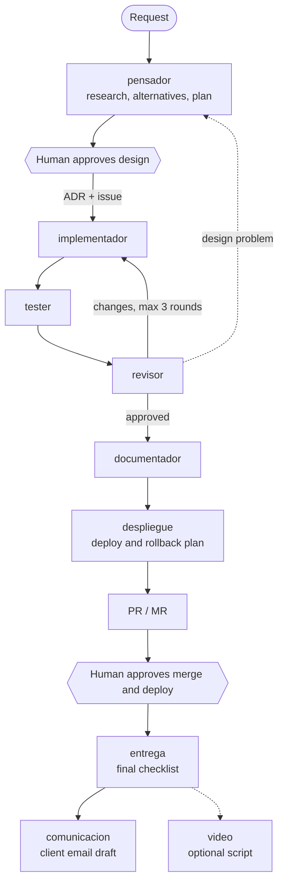

<div align="center">

# kit-agentes

**A team of Claude Code agents that designs, builds and reviews AWS serverless infrastructure: research first, a human approves, then it ships.**


</div>

---

`kit-agentes` is a [Claude Code plugin](https://docs.claude.com/en/docs/claude-code/plugins) (`kit-adrian-aws`)
that turns a single request into a reviewed pull request. An orchestrator hands the work to specialised agents
(a thinker, an implementer, a tester, a reviewer, a documenter and more) and stops at two points for a human
decision: **the design** and **the merge**. Everything in between is planned, coded, tested, reviewed,
documented and measured by the agents.

> The AI does the work. A human reviews it and helps it think.

## Why it is different

- 🧠 **Thinks before it builds.** Every task starts with research: alternatives compared, documentation
  checked, costs estimated, and a design written as an ADR before a line of code exists.
- 🙋 **Two approvals, no surprises.** No agent pushes, merges or deploys on its own. When something blocks
  them, they stop and ask.
- 🔁 **Built-in review loop.** Implementer, tester and reviewer iterate up to three rounds; a design problem
  goes back to the thinker instead of being patched over.
- 🔐 **Security and scalability by default.** Every agent weighs them even when the task does not ask: the
  thinker designs for them, the implementer applies them, the tester probes them and the reviewer blocks
  uncovered risks.
- 🧩 **Works in any repo.** Nothing client-specific lives in the kit. Each task's rules come from the request,
  the repo's `CLAUDE.md` or `AGENTS.md`, and its git history, so the same kit works on GitLab with TypeScript
  CDK or on GitHub with Python.
- 📊 **Every task is measured.** Time, messages, tokens and API-equivalent cost per agent, captured exactly by
  a local telemetry receiver, plus a full ticket in the repo's issue tracker.

## How it works



Outside the main flow, on demand or on a schedule: `seguridad` (security audit), `costes` (cost report),
`novedades` (AWS and AI news for the client's stack) and `incidencias` (error and alarm diagnosis). Anything
they find that needs changing goes back to the orchestrator as a new task.

The orchestrator keeps a log of every step in `.agentes/tareas/` inside the repo, excluded from git through
`.git/info/exclude` so it never lands in a commit unless the repo asks for it.

## The team

| Agent | Model | Role |
|---|---|---|
| `pensador` | Opus | Researches, compares alternatives, proposes design and plan. Never writes code. |
| `implementador` | Sonnet | Implements the approved design on a branch and runs the repo's checks. No push, no deploy. |
| `tester` | Sonnet | Writes and runs CDK, Lambda and API contract tests. |
| `revisor` | Opus | Reviews against the design and the principles and gives a verdict. Changes nothing. |
| `documentador` | Sonnet | Updates only the docs and `CLAUDE.md` sections the change affects. |
| `despliegue` | Sonnet | Prepares the deployment and rollback plan. Does not deploy. |
| `entrega` | Haiku | Final checklist: merge, pipeline, docs, ADR and log. |
| `comunicacion` | Sonnet | Drafts the email for the client. Sends nothing. |
| `video` | Sonnet | Scene-by-scene script and diagrams for a video of the change. |
| `seguridad` | Opus | Read-only audit of IAM, Cognito, WAF, S3, APIs and secrets. |
| `costes` | Sonnet | Read-only cost report by tag, anomalies and savings. |
| `novedades` | Sonnet | AWS and AI news filtered by the client's stack. |
| `incidencias` | Opus | Read-only diagnosis of errors and alarms. |

Each agent sets its own model and effort, so the expensive models only go where judgement matters.

## Quick start

**Requirements:** [Claude Code](https://docs.claude.com/en/docs/claude-code) 2.1.248 or later,
[`uv`](https://docs.astral.sh/uv/) (`brew install uv`), Python 3, and an AWS profile with **read-only**
permissions (taken from `AWS_PROFILE`, `default` otherwise).

```bash
git clone https://github.com/Edriand/kit-agentes ~/work/kit-agentes

# From the root of the repo you want to work on, launch with a short task name
~/work/kit-agentes/lanzar.sh add-orders-api
```

Then, inside Claude Code:

```text
/kit-adrian-aws:orquestar Add a paginated GET /orders endpoint backed by the existing table.
```

- Start the request with `Modo solo diseño.` to stop after the design.
- Waiting more than an hour to answer? Run `/clear`, then `/kit-adrian-aws:orquestar continuar {slug}` with your
  answer. It resumes from the log with a clean context.
- Any `claude` option goes after the task name, for example `lanzar.sh add-orders-api --model sonnet` to run the
  orchestrator on Sonnet.
- A session opened without the launcher or `--plugin-dir` does not have the kit.

Claude Code adds a `Co-Authored-By` trailer to commits and a line to PRs by default. The kit signs on nobody's
behalf, so turn it off in the repo's `.claude/settings.local.json` (or `~/.claude/settings.json` for all repos):

```json
{ "attribution": { "commit": "", "pr": "", "sessionUrl": false } }
```

## Exact metrics with local telemetry

`lanzar.sh` opens `claude --plugin-dir` with the kit and starts a telemetry receiver on your machine. It only
listens on `127.0.0.1:4318`, stores the exact cost and tokens of every call (subagents included) in
`~/.kit-agentes/telemetria/`, and strips commands, parameters, prompts and email before writing anything.

At the end of each task, `metricas_sesion.py` exports time, messages, tokens and API-equivalent cost per model
and per agent to `.agentes/metricas/`. No `/exit` and no manual task name needed.

- If port 4318 is taken by another collector, the launcher warns and carries on without telemetry. Use
  `KIT_PUERTO_TELEMETRIA` to pick another port.
- The receiver stays in the background for later sessions. Stop it with `pkill -f receptor_telemetria.py`.

## Defaults the kit enforces

Unless the request or the repo says otherwise:

- Conventional Commits in English and branches named `{type}/{slug}`.
- A moving base branch is brought in with merge, never rebase or force-push. Merges, tags and deploys are left to the human.
- Code and repository docs in English.
- Push and PR only after the human says yes.
- Every task gets a ticket in the repo's tracker (GitHub Issues or GitLab Issues) with urgency, estimated vs.
  real time and cost, labels, resources, documents and people. It opens with the design approval and closes
  with the merge.
- Agents that wait on long commands (`implementador`, `tester`) use a one-hour prompt cache.

## Design principles

`principios/` holds the design criteria the agents follow, one file per topic so each agent reads only what it
needs: thinking before building, way of working, CDK, Lambda, APIs, data, identity and security, and security
and scalability. The index is [`principios/principios-diseno.md`](principios/principios-diseno.md). A repo's own
`CLAUDE.md` always wins over the kit's general rules.

The skills turn those principles into repeatable steps:

| Skill | Purpose |
|---|---|
| `orquestar` | The orchestrator: assigns work, asks for approvals and keeps the log. |
| `investigar` | Mandatory research phase: compared alternatives and verified documentation. |
| `disenar-arquitectura` | Architecture proposal with diagram, cost and ADR. |
| `disenar-api` | API contract: resources, auth, errors, pagination. |
| `modelar-dynamodb` | Data model from access patterns. |
| `implementar-cdk` | Conventions for CDK and Lambda implementation. |
| `revisar-cdk` | Review of infrastructure stacks or merge requests. |

## AWS MCP servers

All servers run read-only. `.mcp.json` ships with:

| Server | Use | Credentials |
|---|---|---|
| `aws-knowledge` | Up-to-date docs, blogs, reference architectures, Well-Architected | None |
| `aws-iac` | CDK best practices, construct examples, template validation | AWS profile |
| `aws-serverless` | Lambda, API Gateway and SAM | AWS profile |
| `dynamodb` | Data modelling assistant and model validation (`DDB-MCP-READONLY=true`) | AWS profile |
| `iam` | Users, roles and policies (read-only by default; never pass `--allow-write`) | AWS profile |
| `aws-pricing` | Cost estimate of a design | AWS profile |

Run `/mcp` inside Claude Code to see which ones are connected.

## Repository layout

```text
.claude-plugin/plugin.json   Plugin manifest (name, version)
.mcp.json                    Read-only AWS MCP servers
agents/                      The 13 agents
skills/                      Orchestrator and design/implementation skills
skills/orquestar/scripts/    Telemetry receiver, metrics export and model prices
principios/                  Design principles, one file per topic
plantillas/                  Templates: repo CLAUDE.md, task log, issue ticket
ideas/                       Agent catalogue and product ideas
lanzar.sh                    Launcher with local telemetry
ROADMAP.md                   Phases, pilots and checkpoints
```

## Roadmap

The kit is in its pilot phase: tuning cost and quality on real tasks before taking it to client repos on
GitLab, then to a multi-tenant platform where each client runs it with their own API key or Bedrock account.
See [ROADMAP.md](ROADMAP.md).

---

<div align="center">
Made by <a href="https://github.com/Edriand">Adrián Navarro</a> with Claude Code.
</div>
